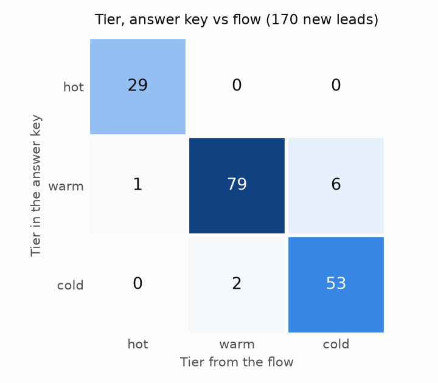

# AI lead qualification and routing for HubSpot

I built an n8n flow that scores each form lead with Claude and routes it into HubSpot, with no duplicate contacts and no lost leads.

## The problem

A small B2B company gets leads through a web form, ends up with the same person twice in its CRM, and answers the good leads late. Someone has to read every message to decide who deserves a call today.

## How it works


- The form posts JSON to an n8n webhook. `Normalize` cleans email, name, phone and website and flags junk.
- If the submission id is already in `lead_log`, the flow answers `already_processed` and stops.
- The contact is read from HubSpot by email. A person HubSpot already knows only gets the new submission id.
- Claude (`claude-haiku-5-5` with a forced `record_score` tool call) returns a score from 0 to 100, a tier, an intent and a one sentence reason. If the call fails or the answer is out of range, `Rule score` uses a fixed rule.
- The flow finds or creates the company, creates the contact with the `lead_*` properties, and creates a deal for hot and warm leads. Hot leads get an owner and a Slack alert with a link to the deal.
- Every lead ends up in `lead_log` in Supabase Postgres. If HubSpot fails, the lead goes to `failed_leads` instead and `replay_failed.py` sends it again later.

| Tier | Score | What happens |
| --- | --- | --- |
| hot | 70 to 100 | deal in the first stage, owner set, Slack alert |
| warm | 40 to 69 | deal in the first stage |
| cold | 0 to 39 | contact only |

## Results

I sent 200 synthetic leads through the flow: 170 new people, 20 resends and 10 junk. Full numbers and the tier matrix are in [docs/report.md](docs/report.md).

| What I measured | Result |
| --- | --- |
| Duplicate contacts from resends | 0 (20 of 20 blocked) |
| Junk leads rejected | 10 of 10 |
| Tier matches the answer key | 161 of 170 (94.7%) |
| Hot leads alerted in Slack | 30 of 30, median 3.8 s from webhook to alert |
| Leads lost | 0 of 200 (3 queued in the outage test, all replayed) |
| Scored by the fallback rule | 7 of 170 |

No hot lead in the answer key was missed. 6 of the 9 tier misses scored a warm lead as cold.



The leads come from `scripts/make_leads.py` (seed 42) and are written for Fieldnote, a made-up SaaS that tracks construction projects. Emails and sites use example.com subdomains and phones use ranges reserved for film and TV, so nothing points to a real person. The answer key in `data/expected.csv` uses this rule:

| Intent | Expected tier |
| --- | --- |
| demo_request, pricing | hot if the sender is an owner, director, operations manager or project manager at a company with 51+ people, otherwise warm |
| support_existing_customer, partnership | warm at 51+ people, otherwise cold |
| job_seeker, spam | cold |

## Reliability

- **Duplicates.** The flow reads the contact by email before it creates anything, so a resent form updates the existing contact. In the test, 20 of 20 resends hit the existing contact and HubSpot ended with exactly 170 contacts.
- **Safe resend.** Every lead carries a submission id. If that id is already in `lead_log`, the flow answers `already_processed` and does nothing else, so a retry is harmless.
- **AI fallback.** If the Claude call fails twice, or its answer is out of range, `Rule score` scores the lead from job title, company size and words in the message. With an invalid API key, 5 of 5 leads still reached HubSpot. In the normal run it also caught 2 answers whose score did not match their own tier.
- **Failure queue and replay.** Each HubSpot call retries 3 times, 2 seconds apart. If it still fails, the lead goes to `failed_leads` with the node name, the error and the original payload, and the form gets a 202. With an invalid HubSpot token, 3 of 3 leads were queued and `replay_failed.py` brought all 3 back in.
- **Slack.** If the alert fails, the lead is not queued, because it is already in HubSpot. Only `alerted_at` stays empty.
- **Anything else.** An error outside these paths runs the `portfolio lead errors` workflow, which posts the node, the error and the execution link to Slack.

## Run it yourself

1. Create a virtual environment with Python 3.11 and install `requirements.txt`.
2. Copy `.env.example` to `.env` and fill it in. You need an n8n with the public API on, a HubSpot private app token (contacts, companies, deals, contact schemas, owners), an Anthropic API key, a Supabase session pooler URL and a Slack incoming webhook.
3. Check the services and set everything up:

```bash
python scripts/check_env.py
python scripts/create_tables.py
python scripts/setup_hubspot.py
python scripts/setup_n8n.py
python scripts/deploy_n8n.py
```

4. Generate and send the test leads, replay anything queued, and build the report:

```bash
python scripts/make_leads.py
python scripts/send_leads.py
python scripts/replay_failed.py
python scripts/report.py
```

5. To send a lead by hand, open `form/index.html?webhook=https://<your-n8n>/webhook/lead-intake`.
6. After editing a workflow in the n8n editor, `python scripts/export_n8n.py` saves it back to `n8n/` with the markers in place. It fails if a token, key, Slack URL or portal id is left in the JSON.

## Notes

- Supabase's free plan allows 2 projects, so this repo shares a portfolio project with other work. It connects as its own role, `lead_routing`, whose default schema is also `lead_routing`. That role cannot read or write any other table in the project.
- Slack's "Create New App" dialog no longer has a "From scratch" option. I used "Pick features" and added only the `incoming-webhook` scope.
- I create the n8n credentials with `scripts/setup_n8n.py` through the n8n API instead of by hand, so no secret is typed or shown on screen. They are named `portfolio lead-routing ...` because another portfolio project on the same n8n already uses `portfolio Anthropic` and `portfolio Supabase`. The HubSpot and Anthropic credentials only work for their own API domain.
- The n8n Postgres credential has "Ignore SSL Issues" on. Supabase's pooler signs its certificate with its own CA and this credential type has no field for a custom CA, so the connection is encrypted but the certificate is not checked. The stricter option is to add Supabase's CA to the n8n server with `NODE_EXTRA_CA_CERTS`.
- `Find contact` reads the contact by email with HubSpot's batch read instead of search. Search can lag a few seconds behind a new contact, and in the test data 5 duplicates arrive 3.5 to 7.5 seconds after the first message.
- The flow has a few nodes the plan did not name: an IF after `Seen before?`, one Respond node per outcome, and `Find company`, `Company exists?` and `Create company` for the company upsert. `Rule score` also passes a valid AI score through, so later nodes read the score from one place.
- In HubSpot, private apps now live under Development > Legacy apps. The plain `tickets` scope is gone, so the app has `crm.objects.tickets.read` and `crm.objects.tickets.write` instead.
- `send_leads.py` sends at most 2 leads per second and waits for each answer, so a duplicate is never in flight with its original. The 200 leads took 9.8 minutes.
- `scripts/export_n8n.py` is not in the plan. I added it so edits made in the n8n editor come back to the repo without secrets.
- The form reads the webhook URL from `?webhook=`, so my n8n address is not in the repo.
