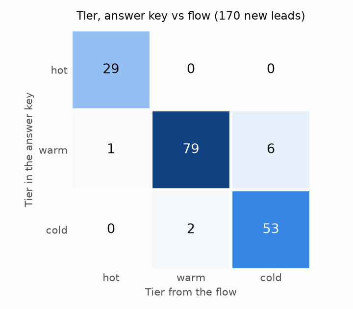

# Lead routing test report

Built by `scripts/report.py` on 2026-11-06 from `lead_log` and `data/expected.csv`. 200 synthetic leads went through the n8n flow.

## Paths

| Path | Leads |
| --- | --- |
| new | 170 |
| duplicate | 20 |
| rejected | 10 |

- Duplicates blocked: 20 of 20 (100.0%).
- Junk rejected: 10 of 10 (100.0%).
- Leads queued after a failure and replayed: 3 of 3.

## Scoring

- Tier matches the answer key: 161 of 170 (94.7%).
- Tier matches when the AI scored the lead: 154 of 163 (94.5%).
- Intent matches the answer key: 170 of 170 (100.0%).
- Scored by the fallback rule: 7 of 170 (4.1%).

Rows are the answer key, columns are what the flow decided:

| Answer key | hot | warm | cold |
| --- | --- | --- | --- |
| hot | 29 | 0 | 0 |
| warm | 1 | 79 | 6 |
| cold | 0 | 2 | 53 |

## Speed

- Median time from the webhook to the Slack alert: 3.8 s over 30 alerts.
- Median webhook response: 3.6 s over the last 200 sends.
- Hot leads: 30, alerts sent: 30.
